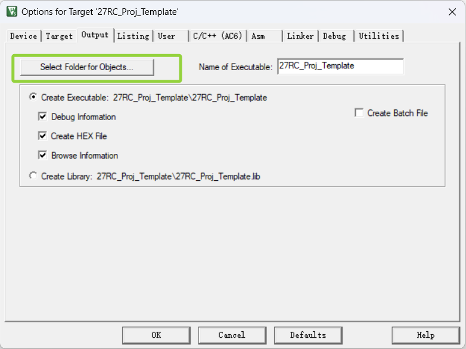
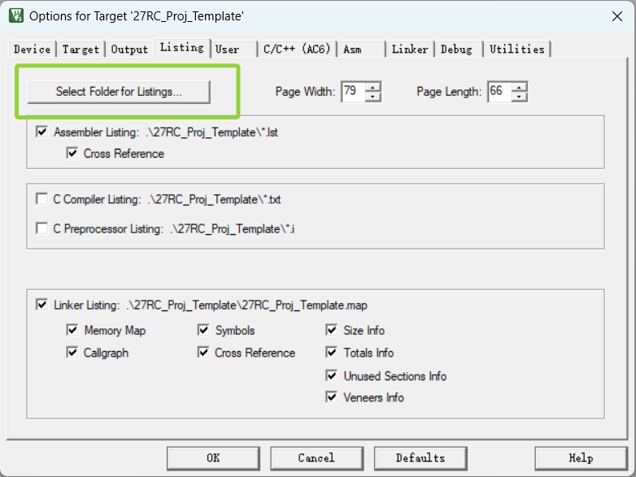

# 工程重命名移植参考

> 本教程着重讲解,在拿到一个模版工程后,如何将工程名称、工程路径等进行修改,以便于在新项目中使用。

## 1.复制工程

将 `27RC_Proj_Template` 目录复制到新项目目录,并重命名为新项目名称,例如 `MyProject`,然后将项目名称复制到剪贴板。

## 2.修改工程文件

使用 `F2` (重命名) 将工程目录下的所有 `27RC_Proj_Template` 替换为新项目名称 `MyProject`,包括:
- `MDK-ARM/27RC_Proj_Template.uvprojx`
- `MDK-ARM/27RC_Proj_Template.uvoptx`
- `./27RC_Proj_Template.ioc`

## 3.删除不必要的文件

删除`MDK-ARM`目录下不需要的文件,例如:
- `27RC_Proj_Template.uvguix.xx`
- `MDK-ARM/27RC_Proj_Template` 整个文件夹
- `MDK-ARM/DebugConfig` 整个文件夹
- `.git`文件夹推荐删除,如果你不想琢磨git操作的话

在`MDK-ARM/`路径下创建新项目名称的文件夹 `MyProject`

## 4.配置keil工程输出路径

- 打开 `MDK-ARM/MyProject.uvprojx`,在 `Options for Target` -> `Output` 中修改输出路径为新项目名称,例如:
- `Executable` 改为 `MDK-ARM/MyProject`
  
- (可选)`Listing` 改为 `MDK-ARM/Listing` (自行创建 `Listing` 文件夹)
  